# Diorama Tactics

A card-driven tactics game built with three.js and TypeScript. You move your army over pixel-art "diorama" maps, and every attack opens a full-resolution battle that plays out blow by blow. Allies standing around a leader join the attack as a **Union**, cards set how far the army moves and how hard it hits, and an AI opponent plays its turns by exactly the same rules.

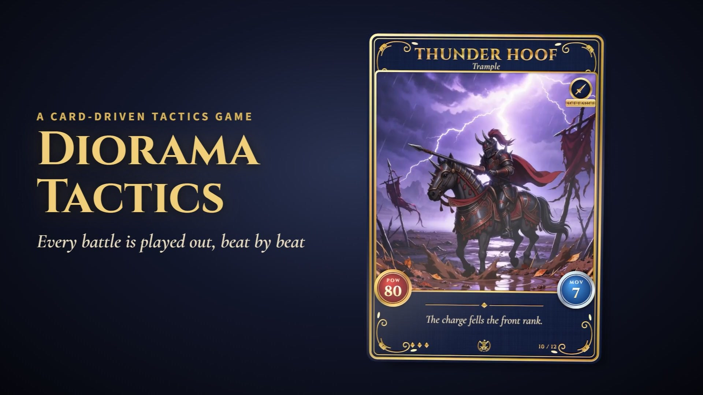

> ## Disclaimer: fan-inspired, not affiliated
>
> This is an **independent, non-commercial hobby project made for learning**. Its gameplay ideas and art direction are **inspired by** *Yggdra Union* (Sting) and the *Final Fantasy Tactics* series (Square Enix).
>
> - It is **not affiliated with, endorsed by, or connected to** Sting, Atlus, Square Enix or any other rights holder.
> - It **does not include any assets from those games**: no sprites, artwork, music, sound, text, characters, story or code. The maps, the map sprites, the effects and the sound are made by the code in this repository. The battle and card art was generated for this project with image and video models (Google Flow, Seedream and Seedance) from prompts that name no other game or artist.
> - *Yggdra Union*, *Final Fantasy* and *Final Fantasy Tactics* are trademarks of their respective owners. They are named only to say where the inspiration came from.
> - It is not meant to infringe any copyright or trademark. If you are a rights holder and have a concern, please open an issue and it will be addressed promptly.

## Contents

- [How a turn plays](#how-a-turn-plays)
- [Battles](#battles)
- [Unions](#unions)
- [Cards and skills](#cards-and-skills)
- [The AI opponent](#the-ai-opponent)
- [The maps](#the-maps)
- [Run it](#run-it) and [Controls](#controls)
- [How it's built and tested](#how-its-built-and-tested)
- [Status](#status) and [Visual history](#visual-history)

## How a turn plays

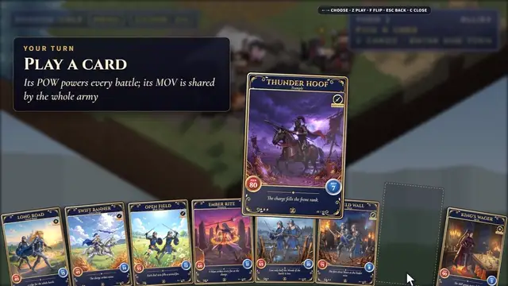

Each side has five heroes, and each hero leads a squad of soldiers. A skirmish ends when one side has no one left standing.

1. **Play a card.** You hold a hand of 8 cards and play one each turn. Its **POW** is the strength of every battle that turn. Its **MOV** is a pool the whole army shares: every tile walked costs 1 MOV, so one long march or several short ones. Its **ACE** names the weapon that can fire the card's skill.
2. **Move.** Select a unit to see its reach, pick a tile to see the path and what it costs, then **CONFIRM** or **UNDO** the move. Each unit moves once a turn.
3. **Attack.** Click a foe next to one of your units. The battle opens over the board, and the loser's Morale goes down when you come back to the map. You get one attack a turn, then the foes take theirs.

Pointing at any unit opens a small window with its painted portrait, Morale, skill gauge and stats. A gold sparkle marks every unit whose skill gauge is full.

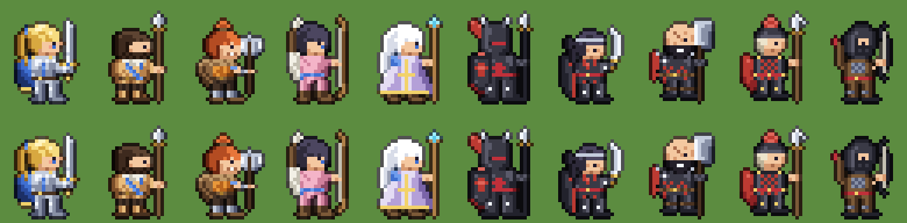

## Battles

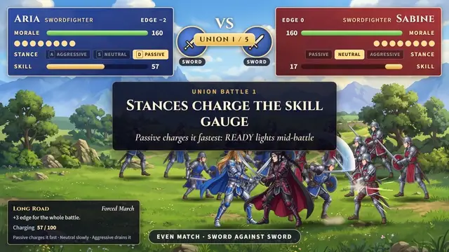

Battles are not pixelated: they run at full device resolution with smooth, layered art. Each one is a real fight simulated by the rules core, with the same seed giving the same result, and the scene acts out what the rules decide:

- **The beats:** the charge, the counter, then one-on-one duels (head against head, soldier against soldier) until one side has nobody left. The fallen drop, the winners cheer, and the Morale lost is counted up.
- **Stance:** **A** (Aggressive), **S** (Neutral) or **D** (Passive) changes your squad's edge from the next beat. It also drives the **skill gauge**: Passive charges it +40 a beat, Neutral +20, and Aggressive drains it.
- **The weapon triangle:** sword beats axe, axe beats spear and lance, spear beats sword, and lance beats sword. Each win is worth +2 edge. Bows and staves stand outside the triangle.
- **Skills:** when the gauge is full and your leader wields the card's ACE weapon, **READY** lights. Press **K** to fire the skill, either at the opening or mid-battle, or **Space** to keep it. A fired skill plays a cut-in with the card's clip, then its own animation where it lands.

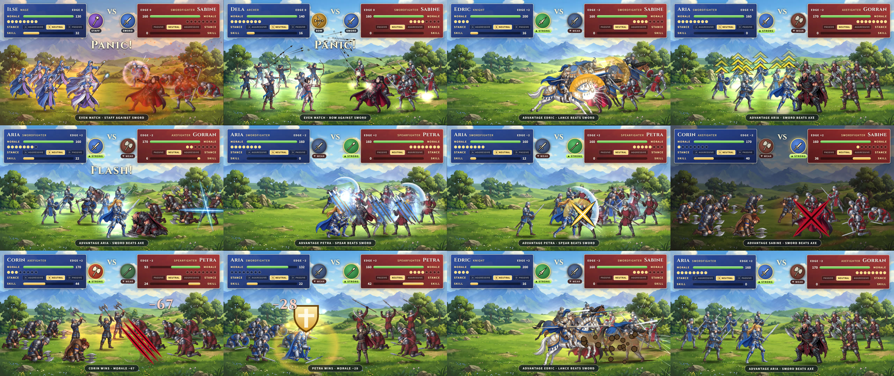

## Unions

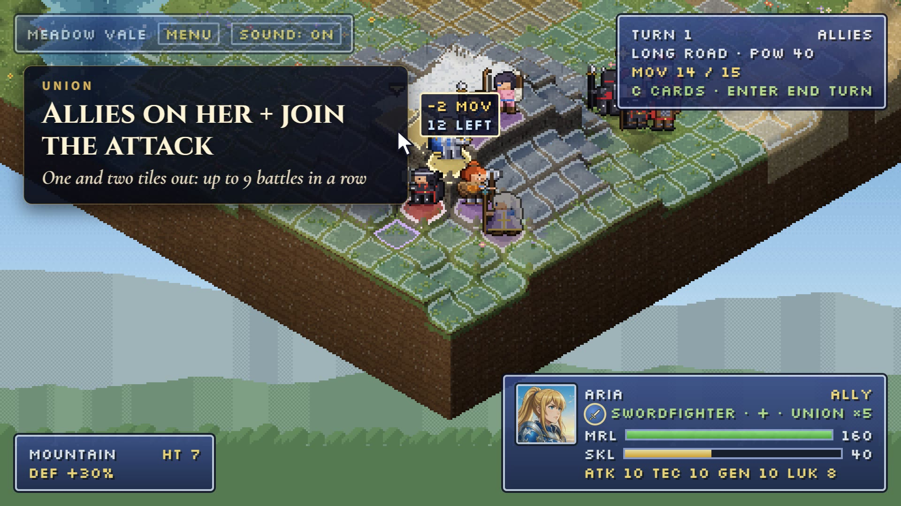

A unit never attacks alone. The allies standing on its **Union shape** fight with it: a **+** for a woman leader and an **×** for a man, reaching one and two tiles out. That's up to 9 battles in a row against the same foe, the near ring first.

The skill gauge is handed down the chain. Each member's battle opens on the gauge the one before it ended on, added to its own, so a Passive opener can set up the next ally to fire a skill straight away.

## Cards and skills

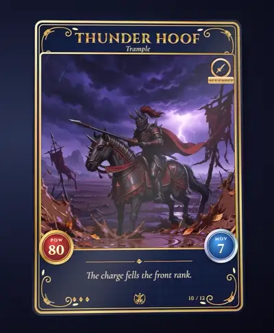

Every card is layered art: a background plate, the figures and a foreground, set at different depths so they part as the card tilts toward the pointer. Each card has a foil sheen and its own hover clip. **F** flips a card to its back.

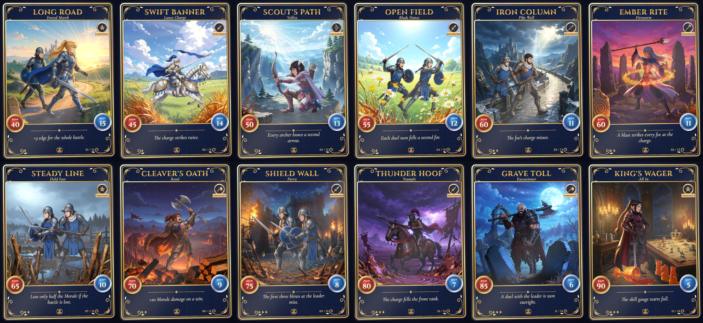

| Card | POW | MOV | ACE | Skill |
|---|---|---|---|---|
| Long Road | 40 | 15 | all | **Forced March:** +3 edge for the whole battle |
| Swift Banner | 45 | 14 | lance | **Lance Charge:** the charge strikes twice |
| Scout's Path | 50 | 13 | bow | **Volley:** every archer looses a second arrow |
| Open Field | 55 | 12 | sword | **Blade Dance:** each duel won fells a second foe |
| Iron Column | 60 | 11 | spear | **Pike Wall:** the foe's charge and counter miss |
| Ember Rite | 60 | 11 | staff | **Firestorm:** a blast strikes every foe at the charge |
| Steady Line | 65 | 10 | all | **Hold Fast:** lose only half the Morale if the battle is lost |
| Cleaver's Oath | 70 | 9 | axe | **Rend:** +20 Morale damage on a win |
| Shield Wall | 75 | 8 | sword | **Parry:** the first three blows at the leader miss |
| Thunder Hoof | 80 | 7 | lance | **Trample:** the charge fells the front rank |
| Grave Toll | 85 | 6 | axe | **Executioner:** a duel with the leader is won outright |
| King's Wager | 90 | 5 | all | **All In:** the skill gauge starts full |

The stronger a card hits, the shorter the march it allows, so every turn trades reach against power.

## The AI opponent

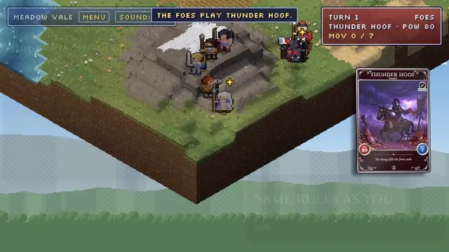

The foes plan a whole turn under the player's rules: one card, the shared MOV pool, one move a unit, one attack, Unions and skills. Every move they make is one the rules would accept from you. Choose how they play in the menu (or with `&foes=hard`):

- **Easy** is bold and simple. It heads straight for your nearest unit and takes whichever fight in reach deals the most Morale.
- **Hard** is cautious and sharp:
  - It scores each card by its POW, plus 30 if one of its units could fire the card's skill.
  - It seeks strong ground and lines a Union up behind its attacker.
  - Before attacking, it runs each possible fight 8 times through the real battle rules, and it only attacks if it wins at least 60% of them.

The panel in the demo isn't written for the camera. It's the AI's own record of what it weighed (`planTurn(..., trace)`), checked against the turn it actually played.

## The maps

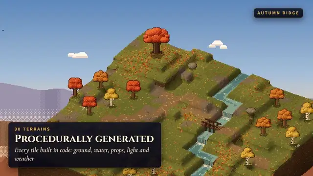

The board is pixel art, drawn through a 480×270 pipeline and scaled up crisply to any screen. Terrain is built in code, tile by tile: stepped heights with rounded edges, painted water that flows down waterfalls, swaying flowers, props, settlements, weather (rain, storms with lightning, settling snow, fog and wind) and a day-night cycle.

There are **30 themed maps**, plus **Wild Lands**: a seeded generator that grows a new valley, island or coast with rivers, bridges, woods and a village, castle or ruins, at 32×32, 48×48 or 64×64.

<details>
<summary>All 30 maps and their URL ids</summary>

| Wilds | Kingdom | Modern | Neon City | Ruins | Elemental |
|---|---|---|---|---|---|
| `alpine` Alpine Pass | `courtyard` Castle Courtyard | `station` Station Square | `market` Night Market Alley | `jungle` Jungle Temple | `volcano` Volcanic Caldera |
| `autumn` Autumn Ridge | `harbour` Harbour Town | `suburb` Suburban Park | `overpass` Highway Overpass | `pyramid` Desert Pyramid | `cavern` Crystal Cavern |
| `desert` Desert Mesa Oasis | `gardens` Royal Gardens | `canal` Canal Quarter | `rooftop` Rooftop Arcade | `sunken` Sunken Temple | `glacier` Glacier Rift |
| `frozen` Frozen Lake | `bridge` Bridge Gatehouse | `highstreet` High Street | `port` Container Port | `colosseum` Overgrown Colosseum | `skyisles` Sky Isles |
| `moor` Highland Moor | `fair` Village Fair | `plaza` Fountain Plaza | `shrine` Shrine Steps | `henge` Stone Circle | `toxicbog` Toxic Bog |

Without `?map=`, the original map (`meadow`, Meadow Vale) loads.

</details>

## Run it

Requires Node 20 or later.

```sh
npm install
npm run dev      # http://localhost:5173
npm test         # unit tests (vitest)
npm run build    # type-check and production build
```

| URL option | What it does |
|---|---|
| `?map=<id>` | Plays a skirmish on that map (see [the maps](#the-maps)) |
| `?map=world`, `&seed=N`, `&size=48` | A Wild Lands map: random, or the same one for a seed, at a bigger size |
| `&foes=hard` | The Hard AI (Easy by default; also in the menu) |
| `&weather=rain`, `&time=dusk` | Weather (clear, rain, storm, snow, fog) and time of day (dawn, day, dusk, night, or a running cycle) |
| `&mode=view` | The map alone, with no units, to look around |
| `?mode=card&id=thunder-hoof` | One card in the showcase |

The menu (**Tab**) also has the map, weather, time, board-size and foe pickers, plus **New map**, **Save** (the map as JSON, one tile per line) and **Load**.

### Controls

| Where | Keys and mouse |
|---|---|
| Map | Drag to orbit, scroll to zoom, WASD to pan. Click a unit, then a tile; **Z** confirms, **X** cancels. Arrow keys move the cursor. **Enter** ends the turn. **C** shows or hides the hand. **Tab** opens the menu. |
| Hand | **←/→** browse the cards, **Z** plays the card in focus, **F** flips it, **Esc** closes. |
| Battle | **A / S / D** set the stance, **K** fires the skill, **Space** fights on (or skips ahead), **Z / Enter / Space** return to the map. |
| Anywhere | **M** mutes the sound. **R** grows a new Wild Lands map, and **E** saves the map. |

## How it's built and tested

- **A pure rules core.** `src/game/` holds the rules: units, the weapon triangle, movement, cards, Unions, skills, the battle simulation and the AI. It's plain TypeScript with nothing from three.js, and a test enforces that. The battle scene and the map read it, but it never reads them, so every fight and every AI decision can be tested without a screen.
- **Tests.** 1,675 unit tests (Vitest), plus 183 headless-browser checks (`scripts/check.mjs`, Puppeteer) that play the real game: turns, battles, Unions, skills, the AI's turns, the layout at laptop size, and loading.
- **Sound** is synthesised in code (`src/audio`): blows, crits, arrows, spells, the charge, cut-ins, cards and the result stings.
- **Art pipeline** (`scripts/art/`): the generated images are keyed off a green screen, turned into pose sets for the battle animations, and composited into the layered cards.
- **The demo video** (`scripts/trailer.mjs`) records the real game frame by frame on a virtual clock (`scripts/trailer/vtime.js`). The page's animation frames, timers, CSS animations and video clips all step together, so the result is smooth however slowly each frame renders.

```
src/game     rules core (pure): units, movement, cards, Unions, skills, battle simulation, AI
src/battle   the battle scene: squads, director, skill effects, cut-ins
src/cards    the layered 3D cards and the card showcase
src/units    units on the map: sprites, the skirmish, deployment
src/map      terrain, rounded surface, mesh, ground painter, liquids, flora, props, generator
src/render   pixel pipeline (480x270, integer upscale), orbit camera, sprites, backdrop
src/themes   the 30 map themes
src/ui       HUD, hand, unit window, turn banners, transitions, result screen
src/audio    synthesised sound effects
scripts      headless checks, snapshots, GIFs, the art pipeline, the demo recorder
evolution    visual history
tasks        plan (todo.md) and lessons learned (lessons.md)
```

## Status

| Phase | | Status |
|---|---|---|
| Map (M0–M16) | Pixel pipeline, terrain, water, cover, settlements, weather, day and night, performance, 30 themes | done |
| B0–B1 | Rules core; units on the map | done |
| B2–B3 | The roster (Google Flow and Seedream art), and the battle scene played from the rules | done |
| B4 | The cards: the hand, the turn rules, and the animated layered cards | done |
| B5–B6 | Unions and card skills | done |
| B7 | The AI opponent (Easy and Hard), victory and defeat | done |
| B8 | Polish: layout, map sprites, portraits, skill animations, move costs, mid-battle skills, two-tile Unions, the demo video | done; the sound effects are in review, and music is still to come |

The full plan is in [tasks/todo.md](tasks/todo.md). The progress ledger is [progress_tracking.json](progress_tracking.json).

## Visual history

The [evolution/](evolution/README.md) folder records how the game was built, stage by stage, for the land, the characters and the battles. Each stage has pictures, what changed, the feedback that caused it and what was learned.

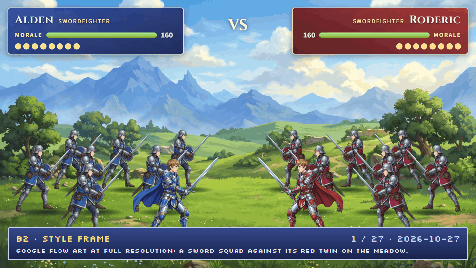

## Built with

- [three.js](https://threejs.org/)
- [Vite](https://vitejs.dev/)
- TypeScript
- [Vitest](https://vitest.dev/)
- [Puppeteer](https://pptr.dev/)
- Art generated with Google Flow, Seedream and Seedance; built with [Claude Code](https://claude.com/claude-code)
